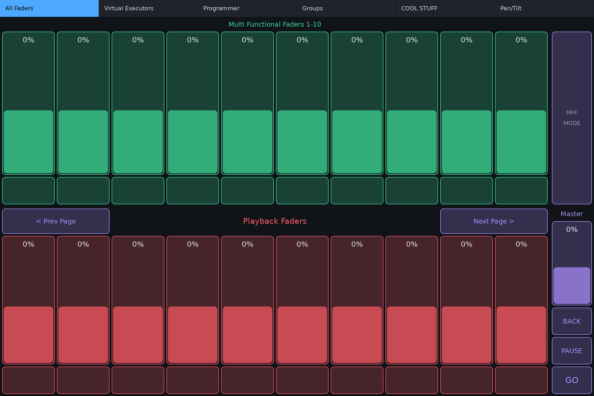
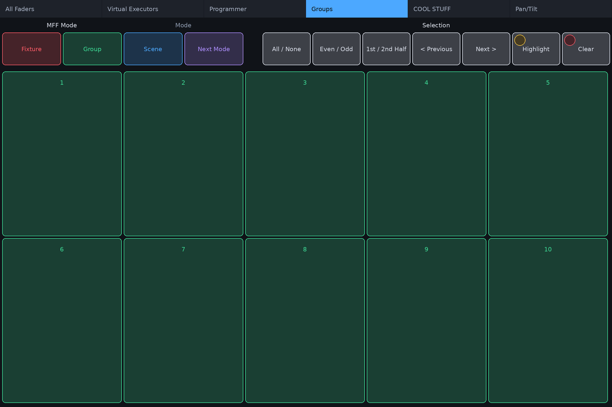
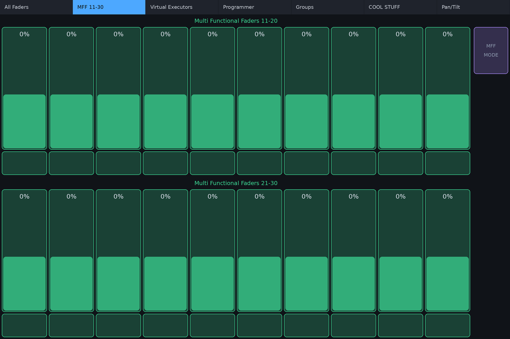

# Lampy TouchOSC Templates

Modern TouchOSC layouts for the **Showtec LAMPY 20** and **LAMPY 40** lighting consoles, built on the official Showtec example template and reworked for a full-screen 3:2 display.

> Images in this README are rendered previews of the layout files, not screenshots from TouchOSC. Colours and corner radius may look slightly different in the app.

## Templates

| File | Console | Pages |
|---|---|---|
| [`templates/Lampy20_OSC_2256x1504_modern.tosc`](templates/Lampy20_OSC_2256x1504_modern.tosc) | LAMPY 20 (10 multi-function faders) | All Faders · Virtual Executors · Programmer · Groups · COOL STUFF · Pan/Tilt |
| [`templates/Lampy40_OSC_2256x1504_modern.tosc`](templates/Lampy40_OSC_2256x1504_modern.tosc) | LAMPY 40 (30 multi-function faders) | All Faders · **MFF 11-30** · Virtual Executors · Programmer · Groups · COOL STUFF · Pan/Tilt |

Both files share the same design, grid and OSC commands. The only differences are the extra **MFF 11-30** page and the 30 select buttons on the **Groups** page in the LAMPY 40 version.

### Pages

- **All Faders** – Multi-function faders 1-10 and playback faders 1-10 across the full width, each with its flash button and name. The right column holds MFF Mode, Next/Prev Page, the Master fader, Back, Pause and Go.
- **MFF 11-30** *(LAMPY 40 only)* – Multi-function faders 11-20 and 21-30 with flash buttons, names and MFF Mode.
- **Virtual Executors** – The 40 virtual executors, Chase Speed, Grand Master, Global FX Speed and Global FX Size.
- **Programmer** – Blind, Highlight, fixture Previous/Next, the 4 encoders, programmer keys (Record, Edit, Delete, attribute groups, Magic, Home, Shift, Fan, Clear) and MFF buttons 1-10.
- **Groups** – One large select button per multi-function fader (10 or 30), direct MFF mode buttons (Fixture, Group, Scene, Next Mode) and selection tools (All/None, Even/Odd, 1st/2nd Half, Previous, Next, Highlight, Clear). The MFF buttons select or deselect groups in Group mode and fixtures in Fixture mode.
- **COOL STUFF** – The original Showtec page with a pan/tilt pad and 16 executors.
- **Pan/Tilt** – A full-screen XY pad (`/lampy/programmer/pan_tilt`) for follow-spot style tracking of the selected moving heads.

## Requirements

- **TouchOSC** (current version by Hexler, not *TouchOSC Legacy*) on Windows, macOS, iOS or Android.
- A **LAMPY** console with OSC input enabled, on the same network as the TouchOSC device.
- The layout is 2256 × 1504 px (3:2). TouchOSC scales it to any screen; on other aspect ratios you will see bars at the sides or top.

## Setup

1. **Network** – Connect the console's Ethernet port to a router or switch and put the TouchOSC device on the same subnet (for example `192.168.1.x`). Showtec recommends a cable or a dedicated router for show-critical use, because OSC runs over UDP without delivery checks.
2. **Console** – Open *Setup → Show Settings → OSC* and turn on *OSC Input Enabled*. Note the console IP and the two ports shown on that page.
3. **TouchOSC** – Open *Connections → OSC → Connection 1* and set:
   - Protocol: **UDP**
   - Host: the console IP
   - Send Port: the port the console lists as **OSC Port (outgoing)** – 8000 by default
   - Receive Port: the port the console lists as **OSC Port (incoming)** – 9000 by default

   The console labels the ports from the remote's point of view. If nothing arrives, swap the two ports.
4. **Load the template** – Open the `.tosc` file for your console and press Play.
5. **Test** – Move a fader and check *Last received command* on the console's OSC page.

Name labels (playbacks, MFFs, executors, encoder texts) stay empty until the console sends its feedback to TouchOSC.

## Known limitations

These commands come from the LAMPY manual (OSC chapter) but have not yet been confirmed on a console. Please report results in an issue.

- **Direct MFF mode buttons** – The manual is ambiguous about the address, so Fixture, Group and Scene send both `/lampy/mff/<mode>` and `/lampy/mff/mode/<mode>`. *Next Mode* always works as a fallback.
- **Selection tools** – `/lampy/programmer/select/all_none`, `even_odd` and `first_second_half` were not part of the original template.
- **Pan/Tilt pad** – Whether the console treats `pan_tilt` as absolute or relative positioning is not documented.

## Changes from the original Showtec template

- Fixed 111 misspelled receive addresses (`/lmpy/...` → `/lampy/...`), which kept playback/MFF names, the Fan and Clear LEDs and encoder texts from updating.
- Removed duplicate labels stacked on the same control.
- Rescaled from 1024 × 768 to 2256 × 1504 and aligned every control to an 8 px grid.
- Rebuilt *All Faders* for full-width faders, added the *Groups* and *Pan/Tilt* pages, and split MFF 11-30 into a LAMPY 40-only page.
- New dark colour scheme with outlined, rounded controls.

## Contributing

Every change to this repository starts with an issue and is delivered through a pull request linked to that issue.

1. **Open an issue** – Choose *Bug report* (something wrong in a template) or *Feature request* (new page, control or console version). Blank issues are disabled, so the forms collect the console model, TouchOSC version and platform.
2. **Wait for agreement** – A maintainer labels the issue and confirms the change before work starts. This avoids duplicate or conflicting layout edits.
3. **Fork and branch** – Create a branch named after the issue, for example `42-add-cue-list-page`.
4. **Edit the template** – Edit the `.tosc` files in the TouchOSC editor with the grid set to 8 px. Bump the version in the file name only when a maintainer asks for it.
5. **Open a pull request** – Use the pull request template and write `Closes #<issue number>` in the description. Add a screenshot of every page you changed.
6. **Checks** – Two automated checks must pass:
   - *PR links an issue*: the description contains `Closes`, `Fixes` or `Resolves` followed by `#<number>`.
   - *Validate templates*: every `.tosc` file opens, has unique control IDs, keeps all controls inside their pages and only sends `/lampy/...` addresses.
7. **Review and merge** – A maintainer reviews the pull request. Merging it closes the linked issue automatically.

See [CONTRIBUTING.md](CONTRIBUTING.md) for details.

## Disclaimer

Based on the TouchOSC example file published by Showtec / Highlite International for the LAMPY series. This project is not affiliated with or endorsed by Showtec, Highlite International or Hexler. LAMPY and Showtec are trademarks of Highlite International; TouchOSC is a trademark of Hexler. Test every template on your own system before using it in a live show.
